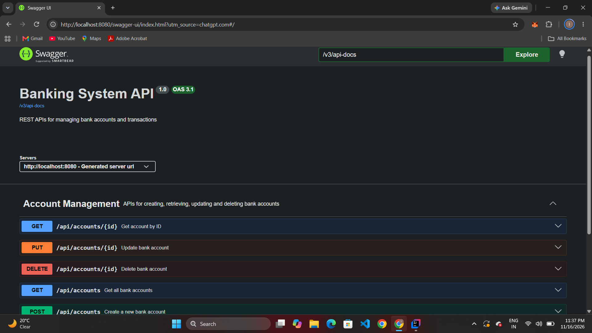

# Banking & Transaction Management System

A backend banking application built using Java and Spring Boot. This project provides REST APIs for managing bank accounts, with database persistence, input validation, exception handling, and interactive API documentation.

## Project Overview

The Banking System is designed to simulate core banking operations through RESTful APIs.

The current implementation focuses on account management, including creating, retrieving, updating, and deleting bank accounts.

The project is being developed with a focus on clean architecture, maintainable code, REST API design, and real-world backend engineering practices.

## Technology Stack

### Backend
- Java 21
- Spring Boot
- Spring MVC
- Spring Data JPA
- Hibernate ORM

### Database
- MySQL 8

### API Development & Testing
- REST APIs
- Postman
- Swagger / OpenAPI

### Build & Development Tools
- Maven
- IntelliJ IDEA
- Git and GitHub

## Features

### Account Management
- Create a new bank account.
- Retrieve all bank accounts.
- Retrieve an account using its ID.
- Update existing account details.
- Delete a bank account.

### Validation & Exception Handling
- Validate account holder name.
- Prevent negative account balances.
- Ensure account numbers are unique.
- Handle missing accounts with HTTP 404.
- Handle duplicate accounts with HTTP 409.
- Return structured JSON error responses.

### API Documentation
- Interactive Swagger UI.
- OpenAPI documentation.
- Documented request and response schemas.
- Documented HTTP response codes.

## Project Architecture

The application follows a layered architecture.

Client (Postman / Swagger UI)
|
v
Controller Layer
|
v
Service Layer
|
v
Repository Layer
|
v
MySQL Database

### Layers Explained

- Controller: Handles incoming HTTP requests and API responses.
- Service: Contains business logic and application rules.
- Repository: Communicates with the database using Spring Data JPA.
- Entity: Represents database tables.
- DTO: Controls the data exposed through API responses.
- Exception: Handles application errors consistently.

## API Endpoints

Base URL: `http://localhost:8080`

| HTTP Method | Endpoint | Description | Success Status |
|---|---|---|---|
| POST | /api/accounts | Create account | 201 |
| GET | /api/accounts | Get all accounts | 200 |
| GET | /api/accounts/{id} | Get account by ID | 200 |
| PUT | /api/accounts/{id} | Update account | 200 |
| DELETE | /api/accounts/{id} | Delete account | 204 |

### Error Responses

| Status Code | Meaning |
|---|---|
| 400 | Bad Request |
| 404 | Account Not Found |
| 409 | Conflict |

## Installation & Setup

### Prerequisites
- Java 21
- Maven
- MySQL 8
- IntelliJ IDEA

### 1. Clone the Repository

Download the project from GitHub:

```bash
git clone YOUR_GITHUB_REPOSITORY_URL
cd banking-system
```

### 2. Create the Database

Open MySQL Workbench and execute:

```sql
CREATE DATABASE banking_system;
```

### 3. Configure Database Credentials

Configure your MySQL username and password in `application.properties`.

### 4. Run the Application

Run `BankingSystemApplication.java` from IntelliJ IDEA.

### 5. Open Swagger UI

http://localhost:8080/swagger-ui/index.html

## Screenshots

### Swagger UI – Account Management APIs




## Transaction Management

The application supports the following banking operations:

- Deposit money into an account.
- Withdraw money with insufficient-balance protection.
- Transfer money between two accounts.
- View account-wise transaction history.
- Prevent transfers between the same account.
- Maintain transaction records for deposits, withdrawals and transfers.
- Use database transactions to ensure atomicity.
- Apply pessimistic write locking to protect concurrent account updates.

### Transaction API Endpoints

| Method | Endpoint | Description |
|---|---|---|
| POST | `/api/transactions/deposit` | Deposit money |
| POST | `/api/transactions/withdraw` | Withdraw money |
| POST | `/api/transactions/transfer` | Transfer money |
| GET | `/api/transactions/account/{accountId}` | View transaction history |
